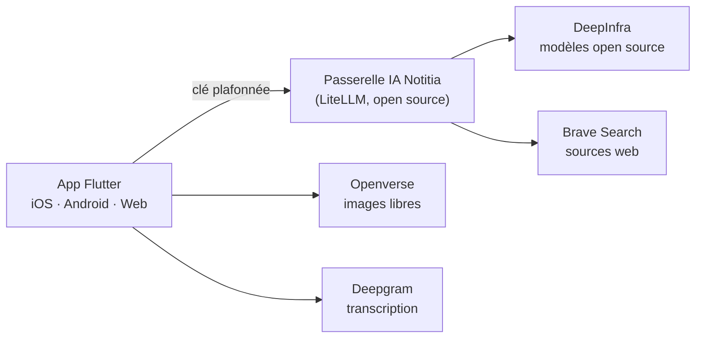

# Période du 9 octobre au 20 novembre 2026 — Passer à une IA open source

> Dates de période à ajuster si besoin. Dernière mise à jour : 16 octobre 2026.

## En une phrase

Le prototype est terminé : on remplace les IA propriétaires (Gemini, Claude) qui
ne fonctionnaient plus par des **modèles open source**, servis par **notre propre
serveur IA**, pour **moins de 10 € par mois**.

## Le problème de départ

- Les clés **Gemini et Claude ne marchaient plus** → assistant, résumé enrichi,
  mind map et recherche sémantique en panne
- **Cause trouvée** : 5 clés API écrites dans le code d'un **dépôt GitHub public**
  → Google et Anthropic détectent et **révoquent automatiquement** les clés publiées
- Dépendance à **4 fournisseurs propriétaires** (Gemini, Claude, Mistral, Deepgram)

> 🎤 Remettre de nouvelles clés au même endroit les aurait fait révoquer à nouveau :
> il fallait changer d'architecture, pas juste de clé.

## Objectifs de la période

1. Remplacer Gemini et Claude par des **modèles open source**
2. **Budget ≤ 10 €/mois** pendant la phase tests + démos
3. Un **serveur IA disponible 24 h/24** pour toute l'équipe
4. **Zéro clé** dans le code de l'application

## Les pistes étudiées

| Piste | Verdict | Pourquoi |
|---|---|---|
| Modèles en local (Ollama) | ❌ | Pas de PC libre, réponses trop lentes sans GPU |
| Serveur GPU loué | ❌ | > 200 €/mois en continu |
| OpenCode Go / Zen | ❌ | Réservé aux agents de code, pas d'embeddings |
| OpenClaw sur VPS OVH | ❌ | Assistant personnel, pas une API pour l'app |
| **API open source payée au token + passerelle** | ✅ | Quelques centimes par mois, aucun GPU à gérer |

## Architecture retenue

- La passerelle ne fait **aucun calcul** : elle relaie → tourne sur un PC ou un petit serveur
- **Une clé par membre** + une pour l'app, chacune avec **son budget plafonné**
- **Bascule automatique** sur un modèle de secours si un modèle tombe
- Changer de modèle = **1 ligne de config**, sans republier l'app

## Les modèles choisis (tous open source)

| Usage dans Notitia | Modèle | Prix / million de tokens |
|---|---|---|
| Correction + titres | Mistral Small 3.2 | 0,08 $ → 0,20 $ |
| Assistant, résumé, mind map | DeepSeek V4 Flash | 0,09 $ → 0,18 $ |
| Mind map premium | Kimi K2.6 | 0,75 $ → 3,50 $ |
| Recherche sémantique | Qwen3-Embedding 8B | 0,01 $ |
| Secours automatique | Qwen3.5 35B | 0,14 $ → 1,00 $ |

> 🎤 Qwen3-Embedding est n°1 du classement MTEB multilingue ; Mistral Small est
> français et excellent en français.

## Budget

| Poste | Coût / mois |
|---|---|
| Serveur (VPS ~2 vCPU / 4 Go) | ≈ 6 € (0 € si offre étudiante) |
| Tokens IA (tests + démos) | ≈ 1–2 €, **plafonné à 4 $** |
| Recherche web, images | 0 € |
| **Total** | **≈ 7–8 €** (objectif ≤ 10 €) |

- ≈ **2 000 générations ≈ 1 $**
- Avant : 3 abonnements API propriétaires

## Ce qui a été réalisé

- **Passerelle IA** prête à déployer : Docker, base Postgres, HTTPS automatique,
  tunnel de démo, scripts de création de clés et de test
- **App migrée** : un seul client IA pour tout (chat, JSON, embeddings, recherche web)
- Mind map : moteurs **Standard / Premium** (au lieu de Gemini / Claude)
- Recherche sémantique : **réindexation automatique** quand on change de modèle
- Résumé enrichi : **vraies images libres de droits** (Openverse) et **vraies sources** (Brave)
- Testé : passerelle démarrée et vérifiée de bout en bout, **9 tests unitaires** ✅

## Sécurité

| Avant | Après |
|---|---|
| 5 clés API en clair dans le code public | **0 clé** dans le code |
| Une fuite = facture illimitée | Une fuite = **budget plafonné** de la clé |
| Clés partagées par toute l'équipe | **Une clé par personne**, révocable |
| Aucune visibilité sur les coûts | **Tableau de bord** des coûts par clé et par modèle |

## Chiffres clés

- **5** modèles open source intégrés
- **5 → 0** clés API dans le code
- **4 → 1** client IA dans l'app (Gemini ×2, Claude, Mistral → un seul)
- **≈ 7–8 €/mois** au total (objectif ≤ 10 €)
- **33 fichiers** modifiés (+1 681 / −1 371 lignes)
- **9** tests automatisés sur le nouveau client IA

## Démo possible

1. Enregistrer une note vocale → correction + titre générés (Mistral Small)
2. Poser une question à l'assistant sur ses notes (DeepSeek + Qwen3)
3. Générer une mind map Standard puis Premium (Kimi K2.6)
4. Montrer le **tableau de bord** de la passerelle : coût de la démo en centimes

## Difficultés et points d'attention

- Les anciennes clés restent dans l'**historique git public** → à révoquer
- Les anciens vecteurs Gemini sont **incompatibles** → réindexation automatique ajoutée
- Pas de PC libre ni de serveur GPU → choix d'une passerelle légère + API au token
- Comportement réel des modèles (vitesse, JSON) **à valider** avec les vraies clés

## Prochaines étapes

- [ ] Révoquer les anciennes clés, passer le dépôt en privé
- [ ] Lancer la passerelle avec les vraies clés + smoke test
- [ ] Mettre la passerelle en ligne **24 h/24** sur un VPS (HTTPS + surveillance)
- [ ] Fusionner la branche `feat/ai-gateway` (PR)
- [ ] Tester l'app complète sur téléphone + préparer la démo

## Sources

- Comparatif embeddings 2026 (OpenRouter), classement MTEB multilingue
- Tarifs DeepInfra, Hetzner, OVHcloud (octobre 2026)
- Documentation LiteLLM, OpenCode Go / Zen, OpenClaw
