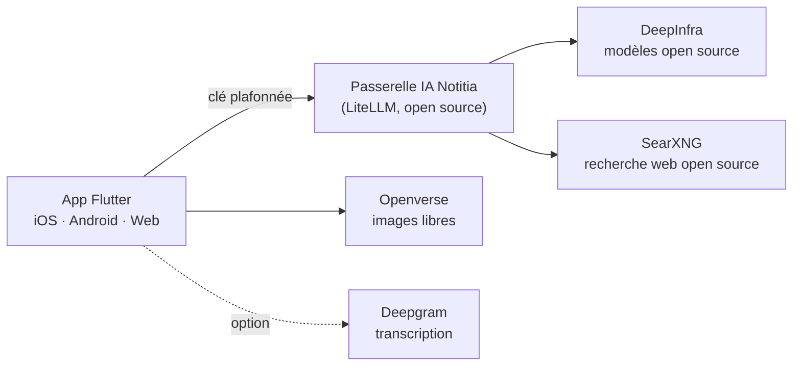

# Période du 9 octobre au 20 novembre 2026 — Passer à une IA open source

> Dates de période à ajuster si besoin. Dernière mise à jour : 17 octobre 2026.

## En une phrase

Le prototype est terminé : on remplace les IA propriétaires (Gemini, Claude) qui
ne fonctionnaient plus par des **modèles open source**, servis par **notre propre
serveur IA**, pour **moins de 10 € par mois**.

## Le problème de départ

- Les clés **Gemini et Claude ne marchaient plus** → assistant, résumé enrichi,
  mind map et recherche sémantique en panne
- **Cause trouvée** : 5 clés API écrites dans le code d'un **dépôt GitHub public**
  → Google et Anthropic détectent et **révoquent automatiquement** les clés publiées
- Dépendance à **4 fournisseurs propriétaires** (Gemini, Claude, Mistral, Deepgram)

> 🎤 Remettre de nouvelles clés au même endroit les aurait fait révoquer à nouveau :
> il fallait changer d'architecture, pas juste de clé.

## Objectifs de la période

1. Remplacer Gemini et Claude par des **modèles open source**
2. **Budget ≤ 10 €/mois** pendant la phase tests + démos
3. Un **serveur IA disponible 24 h/24** pour toute l'équipe
4. **Zéro clé** dans le code de l'application

## Les pistes étudiées

| Piste | Verdict | Pourquoi |
|---|---|---|
| Modèles en local (Ollama) | ❌ | Pas de PC libre, réponses trop lentes sans GPU |
| Serveur GPU loué | ❌ | > 200 €/mois en continu |
| OpenCode Go / Zen | ❌ | Réservé aux agents de code, pas d'embeddings |
| OpenClaw sur VPS OVH | ❌ | Assistant personnel, pas une API pour l'app |
| **API open source payée au token + passerelle** | ✅ | Quelques centimes par mois, aucun GPU à gérer |
| Hébergeur : Azure for Students | Étudiée | VM gratuite 12 mois mais seulement 1 Go de RAM (swap obligatoire) |
| **Hébergeur : OVH VPS-1** | ✅ **retenu** | ≈ 4,6 € TTC/mois, 4 Go de RAM, hébergeur français (datacenter au Canada, pays reconnu « adéquat » RGPD par l'UE), moins cher que Hetzner, IPv4 + anti-DDoS + sauvegarde incluses |

## Architecture retenue

- La passerelle ne fait **aucun calcul** : elle relaie → tourne sur un PC ou un petit serveur
- **Une clé par membre** + une pour l'app, chacune avec **son budget plafonné**
- **Bascule automatique** sur un modèle de secours si un modèle tombe
- Changer de modèle = **1 ligne de config**, sans republier l'app

## Les modèles choisis (tous open source)

| Usage dans Notitia | Modèle | Prix / million de tokens |
|---|---|---|
| Correction + titres | Mistral Small 3.2 | 0,08 $ → 0,20 $ |
| Assistant, résumé, mind map | DeepSeek V4 Flash | 0,09 $ → 0,18 $ |
| Mind map premium | Kimi K2.6 | 0,75 $ → 3,50 $ |
| Recherche sémantique | Qwen3-Embedding 8B | 0,01 $ |
| Secours automatique | Qwen3.5 35B | 0,14 $ → 1,00 $ |

> 🎤 Qwen3-Embedding est n°1 du classement MTEB multilingue ; Mistral Small est
> français et excellent en français.

## Budget

| Poste | Coût / mois |
|---|---|
| Serveur : OVH VPS-1 (Beauharnois, 2 vCore / 4 Go) | ≈ 4,6 € TTC |
| Tokens IA (tests + démos) | ≈ 1–2 €, **plafonné à 4 $** |
| Recherche web, images | 0 € |
| **Total** | **≈ 6–7 €** (objectif ≤ 10 €) |

- ≈ **2 000 générations ≈ 1 $**
- Avant : 3 abonnements API propriétaires

## Ce qui a été réalisé

- **Passerelle IA** prête à déployer : Docker, base Postgres, HTTPS automatique,
  tunnel de démo, scripts de création de clés et de test
- **App migrée** : un seul client IA pour tout (chat, JSON, embeddings, recherche web)
- Mind map : moteurs **Standard / Premium** (au lieu de Gemini / Claude)
- Recherche sémantique : **réindexation automatique** quand on change de modèle
- Résumé enrichi : **vraies images libres de droits** (Openverse) et **vraies sources** via **SearXNG**,
  moteur de recherche open source hébergé sur notre serveur (Brave étant devenu payant)
- **Serveur IA en ligne 24 h/24** sur le VPS OVH, en HTTPS : `notitia-tunnels.duckdns.org` ✅
- Testé : smoke test réel sur le serveur (tous les modèles ✅), **13 tests unitaires** ✅

## Sécurité

| Avant | Après |
|---|---|
| 5 clés API en clair dans le code public | **0 clé** dans le code |
| Une fuite = facture illimitée | Une fuite = **budget plafonné** de la clé |
| Clés partagées par toute l'équipe | **Une clé par personne**, révocable |
| Aucune visibilité sur les coûts | **Tableau de bord** des coûts par clé et par modèle |

## Temps de réponse mesurés (serveur en production)

| Usage | Modèle | Temps |
|---|---|---|
| Correction / titre | Mistral Small 3.2 | 3–4 s |
| Assistant, résumé (JSON) | DeepSeek V4 Flash | 3–5 s |
| Mind map premium (JSON) | Kimi K2.6 | 14–31 s |
| Recherche sémantique | Qwen3-Embedding 8B | 0,5 s |
| Recherche web | SearXNG (sur notre serveur) | 1,3 s |

> 🎤 Mesuré avec le script de test sur le vrai serveur (2 passages, 17 octobre) :
> 5/5 services OK. Kimi est le plus lent → réservé à la mind map premium.

## Chiffres clés

- **5** modèles open source intégrés
- **6 → 0** clés API dans le code (dont la clé Deepgram en dur dans le widget Android)
- **5 → 1** client IA dans l'app (Gemini ×2, Claude, Mistral, Deepgram → un seul)
- **≈ 6–7 €/mois** au total (objectif ≤ 10 €)
- Passerelle mesurée à **≈ 900 Mo de RAM** (LiteLLM ≈ 700 Mo + SearXNG 115 Mo + Postgres 75 Mo)
- **33 fichiers** modifiés (+1 681 / −1 371 lignes)
- **25** tests automatisés sur l'IA (client, transcription, découpage de la parole)
- **0 €** pour la recherche web (SearXNG auto-hébergé au lieu de Brave payant)

## Transcription vocale : passée en open source

| | Avant | Après (17/10) |
|---|---|---|
| Moteur par défaut | Deepgram Nova-3 (propriétaire) | **Whisper large-v3-turbo** (open source) via notre passerelle |
| Coût / heure d'audio | 0,29–0,46 $ | **≈ 0,01 $** (25 à 40× moins cher) |
| Clés dans l'app | Deepgram ×2 (dont 1 en dur dans le widget Android) | **0** (clé passerelle plafonnée) |
| Widget Android | Streaming Deepgram natif | Enregistre un WAV → transcrit à l'ouverture de l'app (marche hors ligne) |

- **Comment** : le micro est découpé sur les pauses (détection de silence), chaque
  morceau est transcrit dans l'ordre → le texte s'affiche au fil de l'eau
- Filtre des phrases que Whisper invente sur le silence (« Sous-titres… Amara.org »)
- Deepgram reste **en option** dans l'écran de capture (200 $ de crédits gratuits)
- **Plus tard** (avec GPU) : vrai temps réel open source auto-hébergé (Kyutai STT, Voxtral Realtime)

> 🎤 DeepInfra n'expose Whisper que par son API native : on a écrit un mini-traducteur
> de 150 lignes, sans dépendance, pour garder la passerelle comme point d'entrée unique.

## Démo possible

1. Enregistrer une note vocale → correction + titre générés (Mistral Small)
2. Poser une question à l'assistant sur ses notes (DeepSeek + Qwen3)
3. Générer une mind map Standard puis Premium (Kimi K2.6)
4. Montrer le **tableau de bord** de la passerelle : coût de la démo en centimes

## Difficultés et points d'attention

- Les anciennes clés restent dans l'**historique git public** → à révoquer
- Les anciens vecteurs Gemini sont **incompatibles** → réindexation automatique ajoutée
- Pas de PC libre ni de serveur GPU → choix d'une passerelle légère + API au token
- Comportement réel des modèles (vitesse, JSON) **à valider** avec les vraies clés

## Prochaines étapes

- [ ] Révoquer les anciennes clés, passer le dépôt en privé
- [x] Lancer la passerelle avec les vraies clés + smoke test (17/10)
- [x] Choisir et commander le serveur : **OVH VPS-1**, livré le 16/10
- [x] Nom de domaine gratuit : `notitia-tunnels.duckdns.org`
- [x] Mettre la passerelle en ligne **24 h/24** sur le VPS en HTTPS (17/10)
- [x] Remplacer Brave (payant) par **SearXNG** auto-hébergé (17/10)
- [ ] Surveillance UptimeRobot + clés `app-demo` et `dev-…`
- [ ] Fusionner la branche `feat/ai-gateway` (PR)
- [ ] Tester l'app complète sur téléphone + préparer la démo
- [x] Nouvelle clé Deepgram (l'ancienne a fuité) — crédits conservés sur le compte
- [x] Transcription open source via la passerelle (Whisper) — capture, réunion, widget (17/10)
- [ ] Tester la transcription Whisper sur téléphone (FR, bruit, longues réunions)

## Sources

- Comparatif embeddings 2026 (OpenRouter), classement MTEB multilingue
- Tarifs DeepInfra, Hetzner, OVHcloud VPS 2027, Azure for Students (octobre 2026)
- Documentation LiteLLM, OpenCode Go / Zen, OpenClaw
